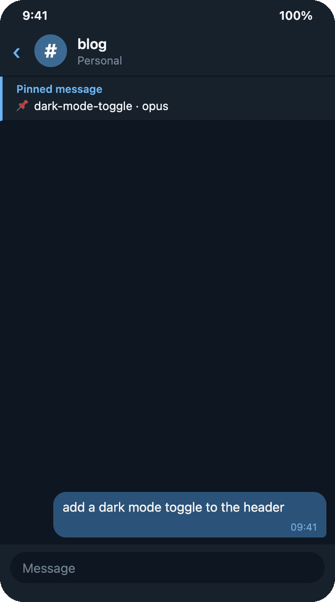
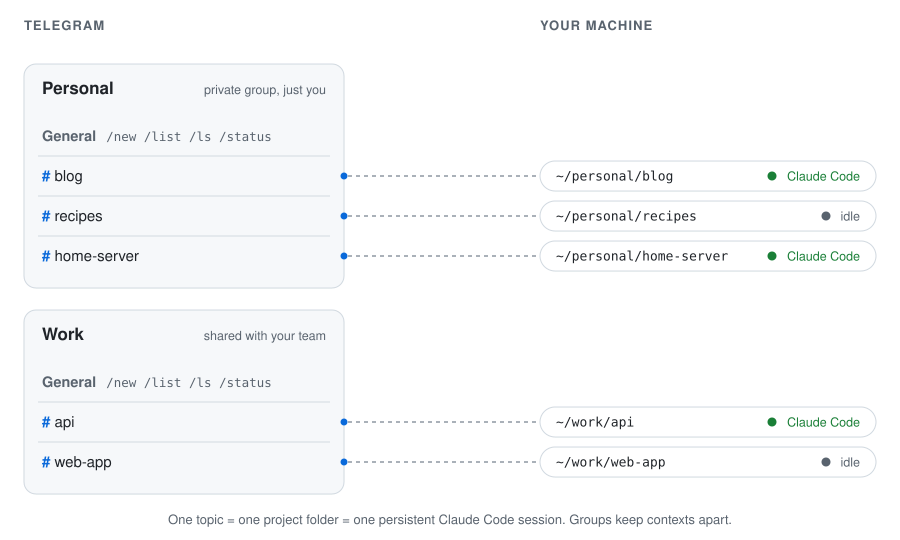
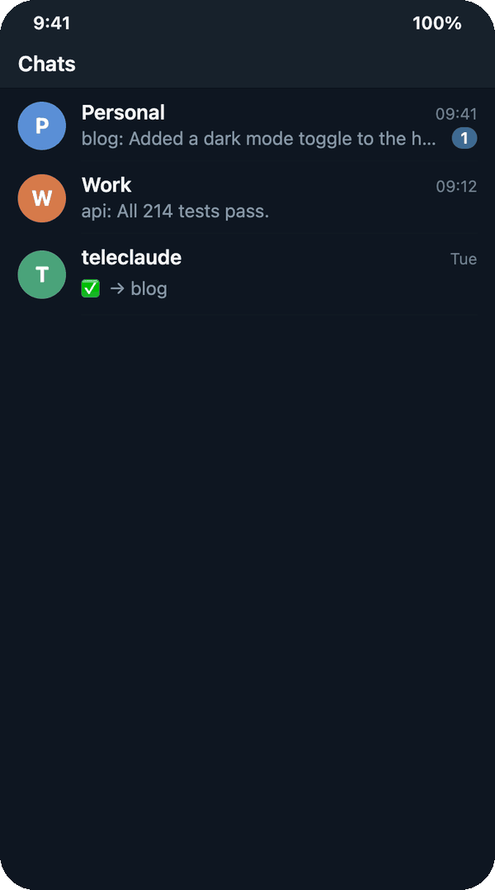
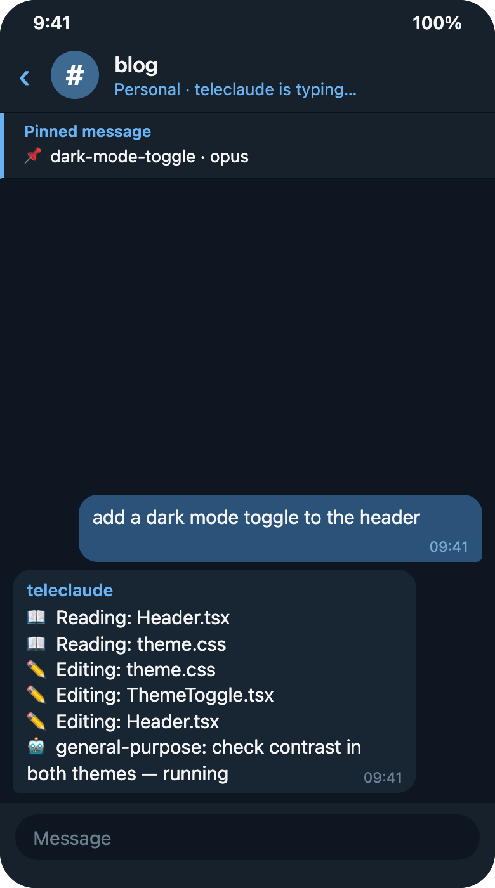
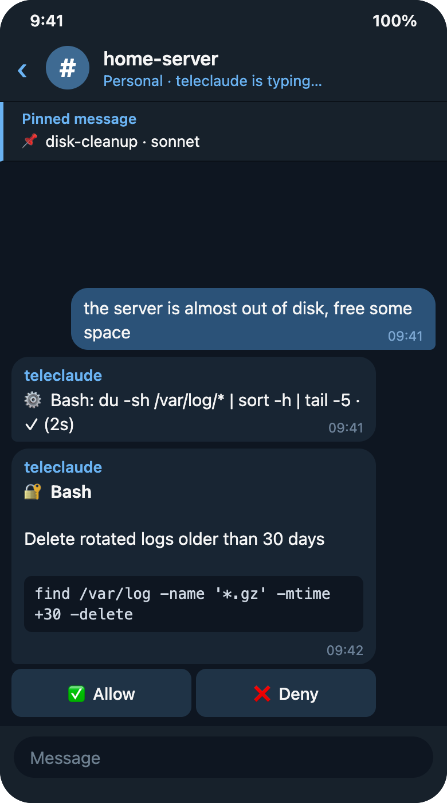

# teleclaude

**Claude Code in your pocket.** Every Telegram forum topic is a project folder
on your machine, with its own persistent Claude Code session. Start a task at
your desk, check on it from the train, answer a permission prompt from the
couch — it's the same session either way.

Works with your Claude Pro/Max subscription — no API key. Runs on your own Mac
or Linux box. Open source under the [MIT license](LICENSE).

<p align="center">
  <br>
  <sub><i>Illustration rendered from teleclaude's real message formats with demo projects — regenerate with <code>npm run media</code>.</i></sub>
</p>

> **Status:** a personal project in daily use, now open for anyone to run. It
> leans on a few Claude Code internals (see [CLAUDE.md](CLAUDE.md)), so a Claude
> Code update can occasionally break something — issues and PRs welcome.

## How it's organized

<picture>
  <source media="(prefers-color-scheme: dark)" srcset=".github/media/topics-dark.svg">
  
</picture>

- **A topic is a project.** `/new blog ~/personal/blog` in a group's General
  topic creates a `blog` topic bound to that folder. Everything you send there
  goes to that project's Claude Code session — no context bleeds between
  topics, and several can work at once.
- **A group is a context.** Keep a private group for personal projects and a
  separate one for work — or share a work group with your team. Each group
  lists and manages only its own projects, and group membership is the access
  boundary.
- **Sessions survive.** Topics resume their conversation after a restart,
  reboot or deploy, and pick up where they left off on the next message.

<p align="center">
  
</p>

## What you can do from your phone

- **Talk to any project.** Text, voice notes (transcribed locally with
  whisper.cpp), photos and files all go straight into the session.
- **Watch it work.** A live view shows the tools Claude is running and its
  subagents, collapsing to the final answer when the turn is done.
- **Stay in control.** Claude Code's auto permission mode vets every action;
  anything it won't allow on its own arrives as **Allow / Deny** buttons. Pick
  fully supervised or bypass per topic with `/permissions`.
- **Schedule work.** `/at 07:00 summarize overnight CI` or
  `/every mon-fri 09:30 check the deploy` — runs survive restarts and retry if
  the session can't start.
- **Spin up projects without a terminal.** `/new` or the `/ls` folder browser
  creates the topic and binds it in one step.
- **See the changes.** `/diff` sends the uncommitted diff as a syntax-highlighted
  page that opens in Telegram's in-app browser.
- **Recover on its own.** Stalled turns and stuck tools raise an alert with
  cancel / force-stop buttons, a failed turn resends your message to a fresh
  session, and a rate-limit alert can schedule "continue working" for the
  moment your quota resets.
- **Hand off to the terminal.** `/handoff` gives you the `claude --resume`
  command to continue the same session at your desk.
- **Drive devices.** Claude can screenshot URLs and operate an Android emulator
  or iOS simulator, sending you what it sees.

<p align="center">
  
  &nbsp;
  
</p>

## Quick start

```bash
git clone https://github.com/fgrebenac/teleclaude.git
cd teleclaude
./scripts/install.sh        # deps, setup (bot token + your Telegram ID), background service
```

Then, in your Telegram group's **General** topic: `/new myproject ~/path/to/project`,
and start talking to it in the new topic. The full walkthrough is in
[ONBOARDING.md](ONBOARDING.md); details below.

## Prerequisites

- **Claude Code** installed and logged in (`claude` command working),
  version **2.1.121 or later**.
- A Claude **Pro or Max subscription** (teleclaude drives Claude Code with
  your existing login — no API key).
- **Channels enabled** on your Claude account. Individual Pro/Max accounts
  have this by default; if your account belongs to an organization, an admin
  must turn on `channelsEnabled` at claude.ai/admin-settings/claude-code —
  without it, topics will never answer (teleclaude detects this and alerts
  you).
- A Telegram bot token from [@BotFather](https://t.me/BotFather).
- A Telegram group with **Topics** enabled, with the bot added as admin and
  granted **Manage Topics**.
- **Node.js 20+.**
- **Linux only:** the installer runs `loginctl enable-linger $USER` so the
  service survives logout; if that fails, run it yourself once.
- For voice messages (optional): ffmpeg + whisper-cpp (`brew install ffmpeg
  whisper-cpp` on macOS) and the model file:

  ```bash
  curl -L --create-dirs -o ~/.teleclaude/models/ggml-base.bin \
    https://huggingface.co/ggerganov/whisper.cpp/resolve/main/ggml-base.bin
  ```

## Install

### 1. Get your Telegram credentials

Before installing, gather three things:

- **Bot token** — message [@BotFather](https://t.me/BotFather), send `/newbot`,
  follow the prompts, and copy the token it gives you (looks like
  `123456:ABC-DEF...`).
- **Your user ID** — message [@userinfobot](https://t.me/userinfobot); it replies
  with your numeric Telegram ID. To share the bot with others, collect each
  person's ID too.
- **A group with Topics** — create a Telegram group, open its settings, and turn
  on **Topics** (Telegram requires a supergroup; converting happens
  automatically). Add your bot to the group and promote it to **admin** with
  "Manage Topics" permission.

### 2. Clone and install

On the machine that will host teleclaude (macOS or Linux):

```bash
git clone https://github.com/fgrebenac/teleclaude.git
cd teleclaude
./scripts/install.sh
```

The installer runs `npm install`, walks you through setup (bot token +
authorized Telegram ID(s)), and installs the background service (launchd on
macOS, systemd on Linux) so the bot auto-starts on boot and restarts on crash.
It's safe to re-run.

All CLI commands run from the checkout as `npx tsx src/index.ts <command>`.

## First run

After the installer finishes (from the checkout directory):

1. **Verify the environment:**

   ```bash
   npx tsx src/index.ts doctor
   ```

   This runs nine checks — Node version, Claude Code presence/version,
   Claude Code login, Telegram bot token, authorized users, each configured
   group's bot membership, project directory paths, optional dependencies
   (ffmpeg/whisper for voice), and a note on the org channels policy. Fix
   anything marked ❌ before continuing.

2. **Setup**, if you skipped it or need to re-run it:

   ```bash
   npx tsx src/index.ts setup
   ```

   Prompts for the bot token and the authorized Telegram user ID(s) — list
   every authorized ID comma-separated (e.g. `123456789, 991234567`); anyone
   not listed is silently ignored.

3. **Create your first project.** In your group's **General** topic, send:

   ```
   /new myproject ~/path/to/project
   ```

   This creates a forum topic for the project; send messages in that topic to
   talk to Claude Code running in that directory. Run `/help` for the full
   command list.

## Everyday use

### Sharing with others / multiple groups

The bot can serve several groups at once: keep your own private group with your
topics, give another person their own private group, and use a shared group for
joint topics. Each group manages its own projects (`/new`, `/list`, `/delete`,
`/status` are scoped to the current group). To grant someone access:

1. Add their Telegram user ID to `ownerTelegramIds` in `~/.teleclaude/config.json`
   (or re-run `npx tsx src/index.ts setup` and list all IDs comma-separated), then restart
   the service.
2. Add them to whichever group(s) you want them to use — group membership is the
   access boundary. In a shared group, anyone in the group can drive that topic's
   session and see its output, so don't put private work in a shared group.

> **Trust model:** whitelisting someone effectively grants shell access as the
> host user. `/new` accepts any path and `/ls` browses the whole filesystem — so
> only whitelist people you'd trust with the machine itself. Topics default to
> Claude Code's **auto** permission mode, where a classifier vets each action
> and anything it blocks falls back to Allow/Deny buttons in the topic. `/permissions`
> switches a topic to fully supervised (ask before every action) or to bypass
> (no checks at all — only for machines where that's genuinely fine).

### Android Emulator (optional)

To use the `android` MCP tool, install the Android SDK command-line tools once:

```bash
# Install Android command-line tools
brew install --cask android-commandlinetools

# Accept licenses
sdkmanager --licenses

# Install emulator + system image (arm64 for Apple Silicon)
sdkmanager "emulator" "system-images;android-34;google_apis;arm64-v8a"

# Create an AVD
avdmanager create avd -n Pixel_7 -k "system-images;android-34;google_apis;arm64-v8a"

# Add platform-tools to PATH (add to ~/.zshrc)
export PATH=$PATH:$HOME/Library/Android/sdk/platform-tools
```

The `android` tool auto-detects a running emulator. Use `{ "action": "launch" }` as the first action to boot one headlessly.

### iOS Simulator (optional)

To use the `ios` MCP tool, install idb in addition to Xcode (which you already have for iOS development):

```bash
# Install idb companion (C++ daemon)
brew install facebook/fb/idb-companion

# Install idb Python client
pip3 install fb-idb

# Verify
idb --help
```

The `ios` tool auto-detects a booted simulator. Use `{ "action": "boot" }` as the first action to boot the first available iPhone simulator.

**Available key names for the `key` action:** `HOME`, `LOCK`, `SIRI`, `SIDE_BUTTON`, `APPLE_PAY`

## Commands

Everything below is registered with Telegram, so the **Menu** button and `/`
autocomplete list it with descriptions — including a shortcut per project
(`/recipes`, `/game_template`, …) that routes a message into that project's
topic. Project names are folded to Telegram's command rules (lowercase,
diacritics stripped, `-` → `_`), and routing accepts either spelling.

### General Topic

| Command | Description |
|---|---|
| `/help` | Show all commands |
| `/new <name> <path>` | Create a project with forum topic |
| `/list` | List this group's projects (🟢 = running) |
| `/delete <name>` | Delete project and topic |
| `/status` | Version, uptime, memory, this group's running sessions |
| `/usage` | Weekly token usage across all projects |
| `/ls [path]` | Browse filesystem, create projects interactively |
| `/update` | `git pull` + `npm install` + restart the bot (safe from chat — detached restart, confirms when back) |
| `/restart` | Restart the bot service (with confirmation button) |
| `/<project> <message>` | Route a message to that project's topic (also works as a DM to the bot) |
| `/at <when> <project> <message>` | Schedule a one-off run (see [Scheduling](#scheduling)) |
| `/every <spec> <project> <message>` | Schedule a recurring run |
| `/schedules` | List schedules with ❌ cancel buttons |
| `/unschedule <id>` | Cancel a schedule |

### Project Topics

| Command | Description |
|---|---|
| `/new [name]` | Start a fresh Claude Code session, optionally named (keeps model/effort/permission settings) |
| `/stop` | Stop Claude Code for this topic |
| `/rename [name]` | Name the running session (no argument = Claude Code names it from the conversation) |
| `/model [id\|alias]` | Switch model via inline buttons (persisted) |
| `/effort [level\|auto]` | Switch effort level via inline buttons (persisted) |
| `/permissions` | Pick Auto / Supervised / Bypass via inline buttons (persisted) |
| `/status` | Show session status, model, permissions |
| `/usage` | Token usage, context window %, session totals |
| `/screenshot <url>` | Screenshot a URL and send as photo |
| `/diff` | Uncommitted git changes: stat summary + `.patch` + a self-contained `.html` preview; optional "🖼 Preview as images" button |
| `/sessions` | List recent sessions with resume buttons — includes sessions started in a worktree or subfolder, labeled `↳ <path>` |
| `/resume <id>` | Resume a specific session |
| `/cancel` | Interrupt just the current turn (Ctrl+C into the session), keeping the session alive |
| `/handoff` | Hand this topic's session to your terminal — stops it here and replies with `cd <path> && claude --resume <id>` |
| `/notify` | Toggle push notification on turn completion (persisted) |
| `/review` | Toggle a turn-end prompt (show diff · ask Claude to commit · leave it) when a turn leaves uncommitted changes |
| `/receipts` | Toggle a one-line turn receipt: duration, tool count, output tokens |
| `/pin` | Toggle the pinned session-name message (default on; the bot needs the "Pin messages" admin right) |
| `/live [full\|summary\|off]` | How much live tool/agent activity a turn shows while it runs |
| `/digest [HH:MM]` | Preset recurring briefings (morning / end-of-day / weekly) |
| `/webhook [new\|off]` | Local inbound webhook that routes a POSTed message into this topic |
| `/at <when> <message>` | Schedule a one-off run in this topic |
| `/every <spec> <message>` | Schedule a recurring run in this topic |
| `/schedules` | List this topic's schedules |

## Scheduling

Wake a session on a timer. The scheduled message goes through exactly the same
path as one you type, so it spawns or resumes the session, waits for the channel
to be ready, and reports stalls the usual way.

```
/at 07:00 recipes log yesterday's meals          # next 07:00, host local time
/at tomorrow 06:15 atlas check the overnight CI
/at 2026-08-02 09:00 atlas prep the release notes
/at +30m recipes remind me about the shopping list

/every day 07:00 recipes morning check
/every mon-fri 09:30 atlas check overnight CI     # also mon,wed / weekday / weekend
/every 30m atlas poll the deploy                  # fixed interval
/every "0 7 * * 1-5" atlas standup summary        # raw 5-field cron

/schedules        # list, with ❌ buttons
/unschedule a3f9  # or an unambiguous id prefix
```

Inside a project topic the project name is implied: `/at 07:00 run the tests`.
From a DM to the bot, the job targets that project's group topic.

Flags go right after the project name:

| Flag | Effect |
|---|---|
| `--new` | Start a fresh session first (drops only the sessionId, like `/new`) |
| `--model <id>` | Switch the topic's model before running (persists, like `/model`) |
| `--effort <level>` | Switch the topic's effort level before running (persists) |

Jobs live in `~/.teleclaude/schedules.json` and survive restarts. A run missed
while the daemon was down still fires if it's less than 30 minutes late;
anything older is skipped with a note in the topic.

A run is only marked done once it actually reached Claude — if the session can't
start or the channel is blocked, the schedule stays put and retries in 5 minutes
(three attempts, then it gives up with a message). Limits: 50 schedules per
group, and 1 minute is the shortest interval.

### Continue after a rate limit

Hitting the 5h cap usually happens mid-task. The quota-exhausted DM comes with
buttons: a toggle per project that was working — ticked already if its session
was live — and **⏰ Continue at reset**.

```
🔴 Claude quota exhausted — 5h session bucket at 100%. Sessions will stall
until it resets · resets in 2h 14m. I'll message you when it's back.

Pick up where you left off?
  [ ✅ Atlas 🟢 ]
  [ ✅ Todo 🟢 ]
  [ ⏰ Continue at reset ] [ ✖️ No thanks ]
```

Confirming schedules a "Continue working" message into each ticked project for
one minute after the limit resets, resuming the existing session with its
context. The confirmation lists an `/unschedule <id>` for each in case you
change your mind.

The buttons stop working 30 minutes after the limit resets — by then the quota
is back and a stale tap would start work out of nowhere. If two people confirm
the same alert, each project is still only scheduled once.

## Updating

From the checkout directory:

```bash
npx tsx src/index.ts update     # git pull --ff-only + npm install + restart
```

From chat: send `/update` in the General topic — it checks how far behind
`origin` you are, confirms with a button, pulls, restarts the service, and
confirms "Back online" in the chat. It refuses if the working tree has
uncommitted changes.

Run `update` and `restart` from a terminal or the `/update` button, never by
asking Claude inside a teleclaude topic to do it — restarting the daemon kills
the session that's running the command.

```bash
npx tsx src/index.ts restart    # restart the service in place
npx tsx src/index.ts version    # show the running version
npx tsx src/index.ts status     # service status
npx tsx src/index.ts logs       # tail the log
```

The running version is also shown by `/status` in Telegram.

## Troubleshooting

Run the doctor first:

```bash
npx tsx src/index.ts doctor
```

It checks Node version, Claude Code presence/version/login, Telegram bot
token validity, authorized users, each group's bot membership, project
directory paths, optional voice dependencies, and reminds you where to look
if topics never answer (the org `channelsEnabled` policy). Fix anything
marked ❌, then retry.

**Logs:**

```bash
tail -f ~/.teleclaude/logs/teleclaude.log
```

The log rotates at 10MB (one previous file kept) and is 0600 — it can contain
message content.

**Topics never answer:** almost always the org channels policy — see
Prerequisites. teleclaude alerts you in Telegram when it detects this on a
spawn attempt.

**A session seems stuck:** use the "⏹ Cancel turn" or "🛑 Force stop session"
button on the stall alert, or send `/stop` and then a new message to respawn.

## Config Files

| File | Purpose |
|---|---|
| `~/.teleclaude/config.json` | Authorized user IDs (`ownerTelegramIds`), `stallAlertMinutes`, `quotaAlertPercent` (DM at N% quota, 0=off), `strictMcpConfig` (default true — load only teleclaude's MCP server, not your global ones) |
| `~/.teleclaude/projects.json` | Project list (name, path, chatId, topicId) |
| `~/.teleclaude/bot_token` | Telegram bot token |
| `~/.teleclaude/sessions.json` | Active sessions keyed `chatId:topicId` (sessionId, chatId, model, effort, permissionMode, lastActiveAt) |
| `~/.teleclaude/logs/teleclaude.log` | Daemon log (0600, rotates at 10MB) |
| `~/.teleclaude/schedules.json` | Scheduled `/at` and `/every` jobs |
| `/tmp/teleclaude-mcp/topic-*.json` | MCP server configs (temp, 0600, cleaned on kill) |
| `/tmp/teleclaude-mcp/settings-*.json` | Per-spawn hook settings, passed with `--settings` (0600, removed on kill) — teleclaude no longer writes hooks into your project directories |

## Development

```bash
npm install
npx tsx src/index.ts start   # run the daemon in the foreground
npm test                     # vitest
npm run typecheck            # tsc --noEmit
npm run build                # optional esbuild bundle into dist/
```

[CLAUDE.md](CLAUDE.md) is the architecture reference: why each piece works the
way it does, the Claude Code behaviours it depends on, and the invariants the
tests pin. It doubles as the context file when you work on teleclaude with
Claude Code. Don't develop teleclaude from inside a teleclaude-hosted session —
restarting the daemon kills the session doing the work.

## Contributing

Contributions are welcome — via pull request. `main` is protected, so every
change goes through a PR that needs passing CI (typecheck + tests) and a
review before it's merged:

1. Fork the repo and branch from `main`.
2. Make your change and keep `npm test` and `npm run typecheck` green.
3. Open a pull request — the template asks what changed and how you tested it.

For bigger changes, open an issue first. See [CONTRIBUTING.md](CONTRIBUTING.md)
for the dev setup, ground rules and what to include in a bug report.

## License

[MIT](LICENSE)
